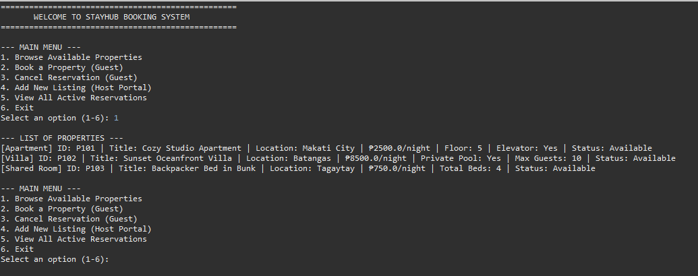
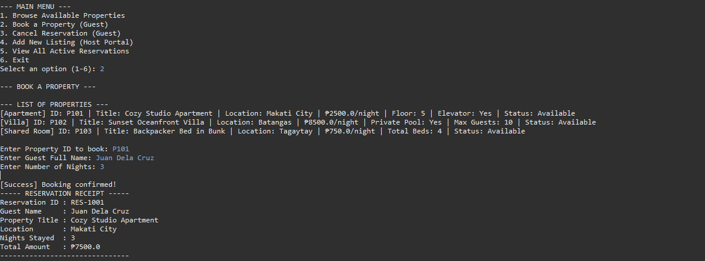

# 🏠 StayHub - Console-Based Airbnb Booking System

An academic Java project demonstrating core Object-Oriented Programming (OOP) concepts including Encapsulation, Abstraction, Inheritance, and Polymorphism.

---

## 👥 Group Members & Roles

* **Gil Lorence Palma** (`@Tsuguosenbei`) - **Team Leader / Architect**
  * Core repository setup, CLI runner engine (`Main.java`), system architecture, and interface design (`Bookable.java`).

* **Kate Darrize De Chavez** (`@dechavezkatkat06-code`) - **Documentation Leader**
  * README documentation, project specifications, and user manual formatting.

* **Erick Angelo Marquinez** (`@25-04986-cloud`) - **System / Design Lead**
  * Abstract base model (`Property.java`) and core domain subclasses (`ApartmentProperty.java`, `VillaProperty.java`).

* **Merald Agda** (`@Merald Agda`) - **Lead Programmer**
  * Subclass models (`SharedRoomProperty.java`), reservation engine (`Reservation.java`), and exception handling logic.

---

## 🛠️ Key System Features
1. **Browse Listings**: View all registered apartments, villas, and shared spaces with live availability.
2. **Guest Booking**: Real-time room reservation with custom exception handling (`PropertyUnavailableException`, `InvalidBookingException`).
3. **Cancel Reservation**: Release booked properties instantly.
4. **Host Portal**: Authenticated listing portal (PIN: `1234`) for adding custom property types.
5. **Reservation Management**: Generate receipt details and manage active guest stays.

---

## 🚀 How to Run the Application

### Prerequisites
- Java Development Kit (JDK) 8 or higher
- Eclipse IDE (recommended) or a terminal
- Git (optional, for cloning the repository)

### Option 1: Run Using Eclipse IDE

1. Download or clone the STAYHUB GitHub repository.
2. Open Eclipse IDE.
3. Select **File > Import > General > Existing Projects into Workspace**.
4. Select the downloaded STAYHUB project folder.
5. Click **Finish**.
6. Expand the `src` folder.
7. Right-click `Main.java`.
8. Select **Run As > Java Application**.
9. Follow the instructions displayed in the console.

### Option 2: Run Using the Terminal

Clone the repository:

```bash
git clone https://github.com/Tsuguosenbei/STAYHUB-AIRBNB-BOOKING-SYSTEM.git
cd STAYHUB-AIRBNB-BOOKING-SYSTEM
```

Compile the Java source files:

```bash
javac -d bin src/*.java
```

Run the application:

```bash
java -cp bin Main
```

### Main Menu

The application provides six menu options:

1. Browse Available Properties
2. Book a Property
3. Cancel a Reservation
4. Host Portal
5. View Active Reservations
6. Exit

### Important Notes

- The application uses a console-based interface.
- Property and reservation data are stored in memory.
- Data created during a session are not saved after the application closes.
- The Host Portal uses a demonstration PIN configured in the source code.

## Application Screenshots

### Main Menu


### Property Listings


### Successful Booking


### Double-Booking Prevention


### Reservation Cancellation


### Host Property Creation


### Input Validation

