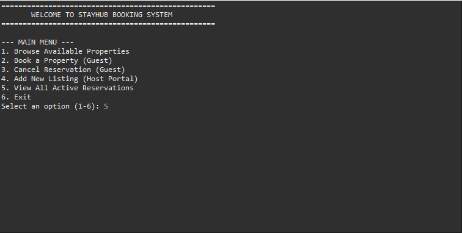
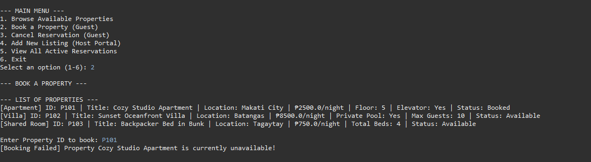
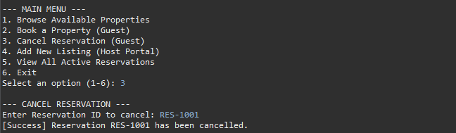
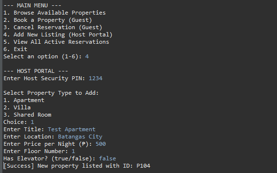
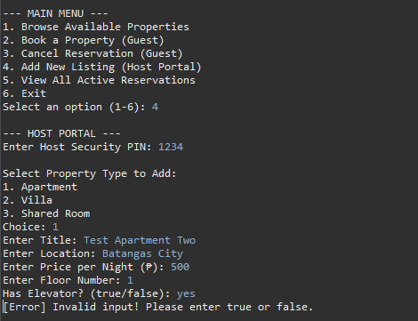
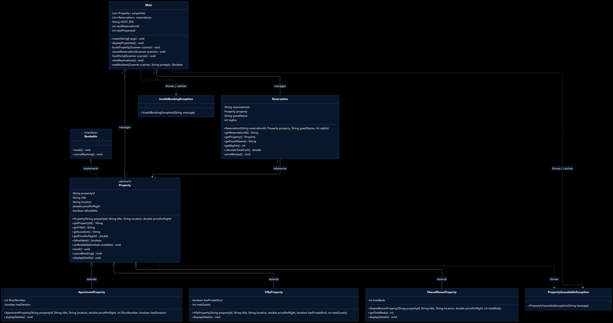

# 🏠 StayHub - Console-Based Airbnb Booking System

An academic Java project demonstrating core Object-Oriented Programming (OOP) concepts including Encapsulation, Abstraction, Inheritance, and Polymorphism.

---

## 👥 Group Members & Roles

* **Gil Lorence Palma** (`@Tsuguosenbei`) - **Team Leader / Architect**
  * Core repository setup, CLI runner engine (`Main.java`), system architecture, and interface design (`Bookable.java`).

* **Kate Darrize De Chavez** (`@dechavezkatkat06-code`) - **Documentation Leader**
  * README documentation, project specifications, and user manual formatting.

* **Erick Angelo Marquinez** (`@25-04986-cloud`) - **System / Design Lead**
  * Abstract base model (`Property.java`) and core domain subclasses (`ApartmentProperty.java`, `VillaProperty.java`).

* **Merald Agda** (`@Merald Agda`) - **Lead Programmer**
  * Subclass models (`SharedRoomProperty.java`), reservation engine (`Reservation.java`), and exception handling logic.

---

## 🛠️ Key System Features
1. **Browse Listings**: View all registered apartments, villas, and shared spaces with live availability.
2. **Guest Booking**: Real-time room reservation with custom exception handling (`PropertyUnavailableException`, `InvalidBookingException`).
3. **Cancel Reservation**: Release booked properties instantly.
4. **Host Portal**: Authenticated listing portal (PIN: `1234`) for adding custom property types.
5. **Reservation Management**: Generate receipt details and manage active guest stays.

---

## 🚀 How to Run the Application

### Prerequisites
- Java Development Kit (JDK) 8 or higher
- Eclipse IDE (recommended) or a terminal
- Git (optional, for cloning the repository)

### Option 1: Run Using Eclipse IDE

1. Download or clone the STAYHUB GitHub repository.
2. Open Eclipse IDE.
3. Select **File > Import > General > Existing Projects into Workspace**.
4. Select the downloaded STAYHUB project folder.
5. Click **Finish**.
6. Expand the `src` folder.
7. Right-click `Main.java`.
8. Select **Run As > Java Application**.
9. Follow the instructions displayed in the console.

### Option 2: Run Using the Terminal

Clone the repository:

```bash
git clone https://github.com/Tsuguosenbei/STAYHUB-AIRBNB-BOOKING-SYSTEM.git
cd STAYHUB-AIRBNB-BOOKING-SYSTEM
```

Compile the Java source files:

```bash
javac -d bin src/*.java
```

Run the application:

```bash
java -cp bin Main
```

### Main Menu

The application provides six menu options:

1. Browse Available Properties
2. Book a Property
3. Cancel a Reservation
4. Host Portal
5. View Active Reservations
6. Exit

### Important Notes

- The application uses a console-based interface.
- Property and reservation data are stored in memory.
- Data created during a session are not saved after the application closes.
- The Host Portal uses a demonstration PIN configured in the source code.

## Application Screenshots

### Main Menu


### Property Listings


### Successful Booking


### Double-Booking Prevention


### Reservation Cancellation


### Host Property Creation


### Input Validation



---

## 📌 Problem Statement

Traditional accommodation booking processes can be inconvenient when guests cannot easily view property details, check availability, or manage reservations in one place.

STAYHUB addresses this problem by providing a console-based booking system where users can browse accommodations, make reservations, and cancel bookings. It also allows hosts to register new properties.

## 🎯 Project Objectives

The objectives of STAYHUB are to:

1. Develop a functional accommodation booking system using Java.
2. Allow guests to browse available properties and make reservations.
3. Prevent double-booking through property availability checking.
4. Allow guests to cancel reservations.
5. Provide a host portal for adding property listings.
6. Demonstrate the four fundamental principles of Object-Oriented Programming.
7. Apply input validation and exception handling to improve system reliability.

## 👥 Target Users

- **Guests:** Individuals looking for accommodations who want to browse listings and manage reservations.
- **Property Hosts:** Individuals who want to register apartments, villas, or shared rooms.
- **Students and Developers:** Individuals studying Java programming and Object-Oriented Programming concepts.

## 🧩 Object-Oriented Programming Concepts

### 1. Encapsulation

STAYHUB uses private attributes to protect class data and public methods to provide controlled access.

**Implementation:** `Property.java` and `Reservation.java` contain private fields and getter methods.

### 2. Inheritance

Inheritance allows specialized property classes to reuse common attributes and behaviors from a parent class.

**Implementation:** `ApartmentProperty`, `VillaProperty`, and `SharedRoomProperty` extend the abstract `Property` class.

### 3. Abstraction

Abstraction allows the application to define essential behaviors without exposing every implementation detail.

**Implementation:** The abstract `Property` class declares `displayDetails()`, while the `Bookable` interface defines `book()` and `cancelBooking()`.

### 4. Polymorphism

Polymorphism allows different property objects to respond differently to the same method call.

**Implementation:** Each property subclass overrides `displayDetails()` to show information specific to its property type.

## 📐 UML Class Diagram

The UML class diagram illustrates the relationships between STAYHUB's classes and interfaces.



## 🧪 Testing and Validation

The application was tested for booking functionality, reservation cancellation, property creation, invalid inputs, and double-booking prevention.

For detailed test cases and results, see:

[STAYHUB Testing Documentation](Docs/TESTING.md)

## ⚠️ System Limitations

- The application operates through a command-line interface.
- Property and reservation records are stored in memory.
- Records are not preserved after the application closes.
- The system does not support real payment processing.
- The Host Portal uses a demonstration PIN rather than a full user authentication system.

## 🔮 Future Improvements

Potential improvements include:

1. Adding a graphical user interface.
2. Implementing database storage for persistent records.
3. Introducing user registration and login.
4. Supporting booking dates and availability calendars.
5. Adding property search and filtering.
6. Implementing payment processing in a future production-ready version.

---

**STAYHUB – Console-Based Airbnb Booking System**

An academic Java project demonstrating Object-Oriented Programming principles through accommodation booking and reservation management.
